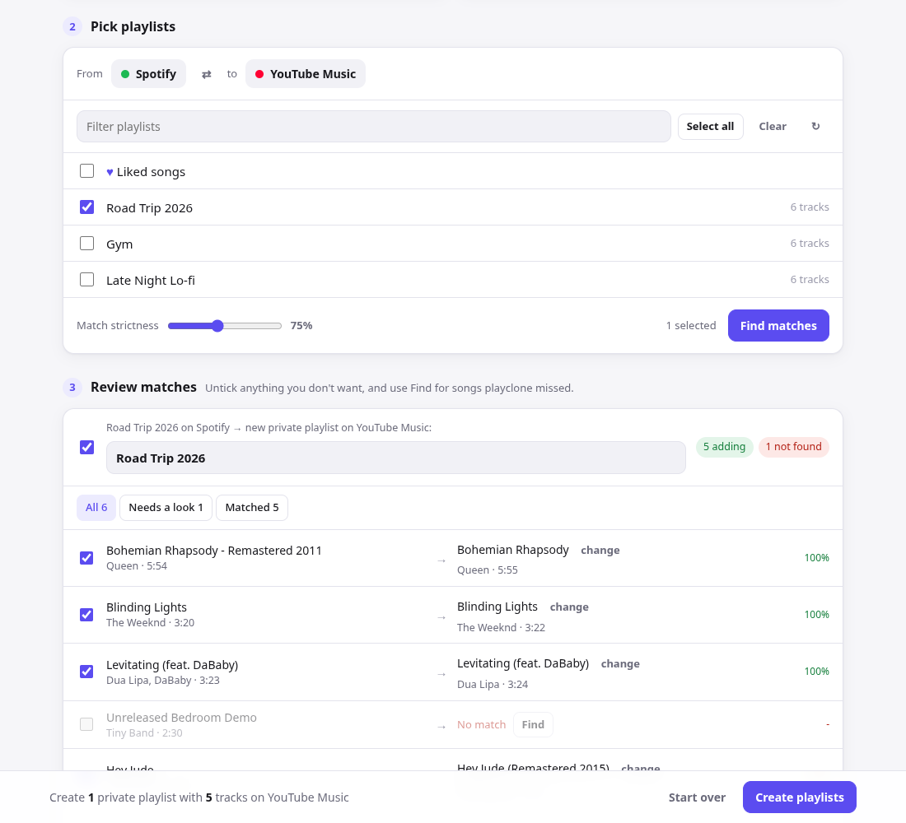

# playclone

Copy playlists and liked songs between **Spotify** and **YouTube Music**, in either direction, from a
local web app.



1. **Connect** both accounts.
2. **Pick** the playlists to copy (Liked songs included) and the direction.
3. **Review** the matches: untick anything you don't want, and use **Find** to search for songs
   playclone couldn't match by itself. Then hit **Create playlists**.

Each track is searched on the other service and scored on title, artist and duration (plus ISRC
codes when both sides have them). Noise like `(Official Video)`, `- Remastered 2011` and `feat. X`
is ignored, and live, remix, acoustic and similar versions are kept apart from the originals.
Uncertain matches are flagged for review, and songs it can't find are left out instead of being
replaced with the wrong song. New playlists are always **private**. Nothing on either account is
ever deleted or modified.

## Two ways to use it

| | **Online**: [yajatghule.github.io/playclone](https://yajatghule.github.io/playclone/) | **Local app**: `uv run playclone` |
|---|---|---|
| Install | Nothing, it runs in your browser | Python 3.12+ |
| Spotify | Your own free Spotify app (Client ID) | Same |
| YouTube Music | Official YouTube Data API: your own free Google OAuth client | Your browser session via ytmusicapi, no Google setup |
| Limits | Google's free daily quota allows about **65 songs/day into YouTube**. Copying *from* YouTube is nearly free. | No daily limit |

Both use the same interface. If a copy into YouTube stops when the daily quota runs out, the online
version saves what's left under **Unfinished playlists** so you can resume after the reset (midnight
Pacific). Matches are remembered, so nothing gets searched twice.

### Online setup

The page shows these steps when you open it.

- **Spotify:** create an app at <https://developer.spotify.com/dashboard>, enable **Web API**, add
  `https://yajatghule.github.io/playclone/` as a redirect URI, and add your email under **User Management**.
  Paste the Client ID into the page.
- **YouTube:** in Google Cloud Console, create a project and enable **YouTube Data API v3**. On the
  OAuth consent screen, choose External and add yourself as a test user. Then create an **OAuth client ID**
  (Web application) with `https://yajatghule.github.io` as an authorized JavaScript origin, and paste
  its Client ID into the page.

Client IDs and sign-in tokens are kept in your browser's local storage. The page only ever talks to
Spotify and Google.

## Install and run the local app

```sh
git clone https://github.com/YajatGhule/playclone && cd playclone
uv sync            # or: pip install .
uv run playclone   # opens http://127.0.0.1:8888 in your browser
```

Requires Python 3.12+. The app runs entirely on your computer. Credentials are kept in
`~/.config/playclone/` with mode 600 (set `PLAYCLONE_HOME` to use another folder).

## Connecting accounts

The app walks you through both of these.

**Spotify:** create a (free) app at <https://developer.spotify.com/dashboard>, enable **Web API**,
add the redirect URI `http://127.0.0.1:8888/callback`, and add your Spotify email under
**User Management**. Paste the app's **Client ID** into playclone and click **Connect Spotify**.
No client secret is needed, because sign-in uses PKCE.

**YouTube Music:** there's no official library API, so playclone uses
[ytmusicapi](https://github.com/sigma67/ytmusicapi) with your browser session. On
music.youtube.com, open DevTools → Network, filter for `browse`, click a POST request, copy its
request headers and paste them into playclone. They stay valid until you sign out of YouTube in that
browser.

## Command line

Everything the app does is also available as commands:

```sh
playclone ui [--port 8888] [--no-browser]                  # the web app (default)
playclone auth spotify --client-id <ID>                    # or: playclone auth ytmusic
playclone list spotify                                     # playlist ids and names
playclone clone --from spotify --to ytmusic "Road Trip"    # by name or id
playclone clone --from ytmusic --to spotify --liked        # liked songs → new playlist
playclone clone --from spotify --to ytmusic --all --dry-run
```

If you change `--port`, the Spotify redirect URI must use the same port.

Matches, including ones you pick by hand in the app, are cached in
`~/.config/playclone/match-cache.json`, so re-runs and overlapping playlists don't search again.

## Development

```sh
uv run pytest
```

- `src/playclone/providers/` has one adapter per service, each with four methods:
  `list_playlists`, `get_tracks`, `search` and `create_playlist`. Apple Music is planned as the next one.
- `src/playclone/server.py` is the local JSON API, built on the standard-library HTTP server.
- `src/playclone/web/index.html` is the whole front end, with no build step. It gets its data from
  `backend.js`:
  - the local app serves `web/backend-local.js`, which calls the Python server
  - the GitHub Pages build ships `site/backend.js`, which does everything in the browser (Spotify PKCE,
    YouTube Data API, a JS port of the matcher) behind the same `/api/*` routes
- `.github/workflows/pages.yml` deploys the online version on every push to `main`.
- `node --test tests/js/*.test.mjs` tests the browser matcher, and `tests/test_js_parity.py` checks that it scores
  the same as the Python matcher.

The server only listens on 127.0.0.1. It rejects requests with a foreign `Host` or `Origin` and
anything that isn't a JSON POST, so other websites can't drive it.

## Notes

- The YouTube Music integration uses an unofficial API and may break when YouTube changes its web
  client. If it does, update `ytmusicapi` first.
- Spotify apps in development mode only work for accounts listed under User Management.
